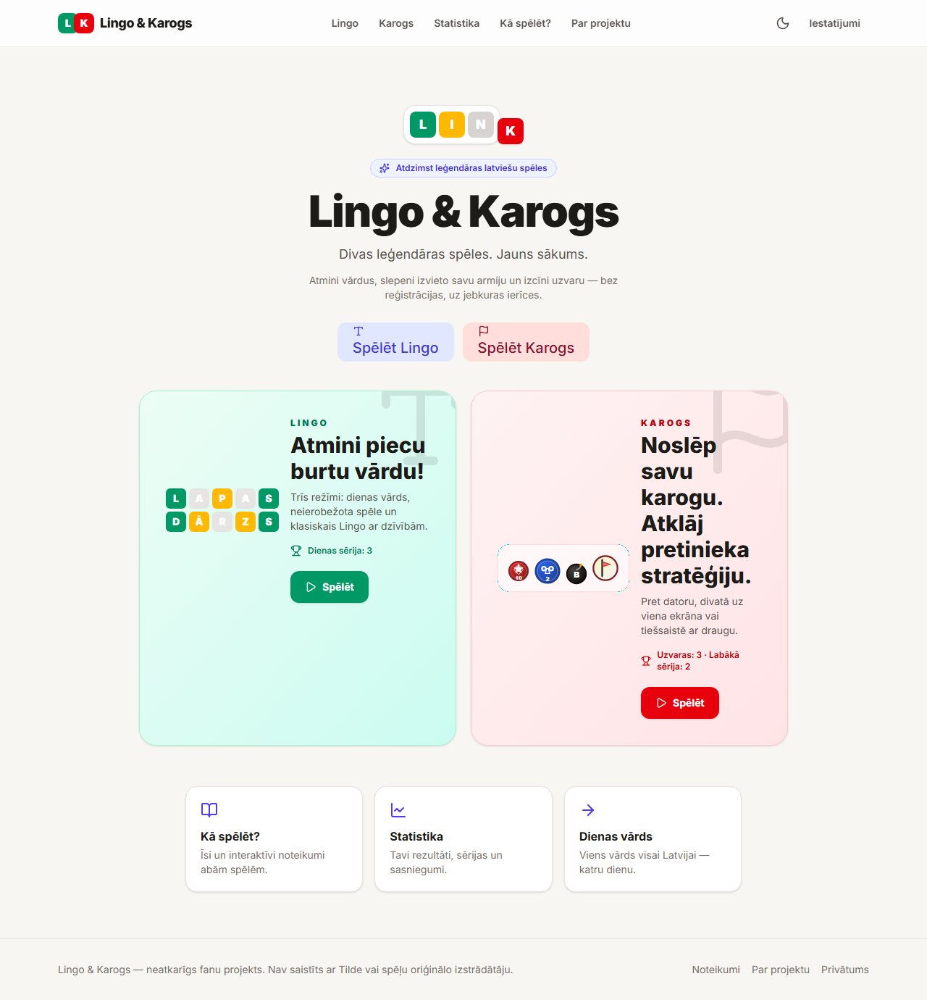
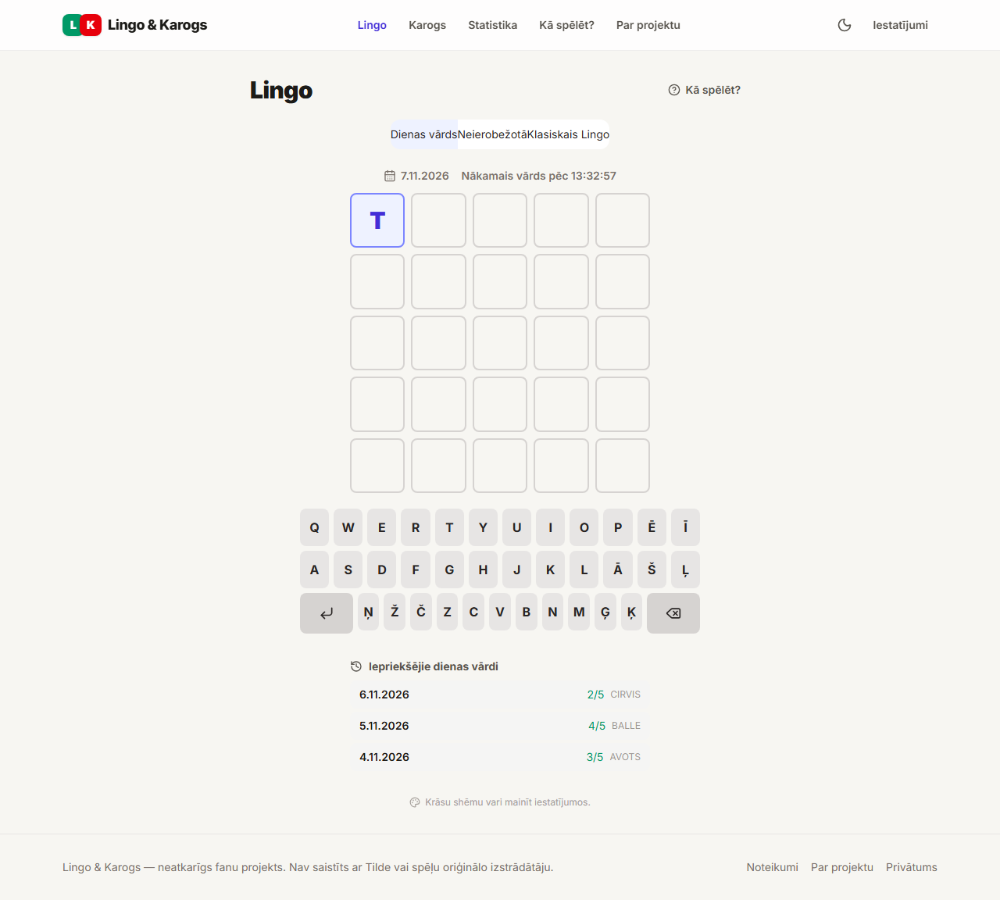
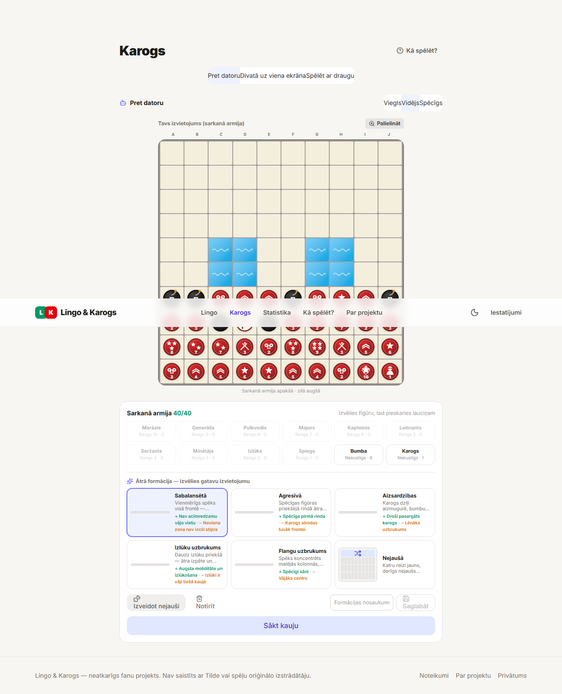
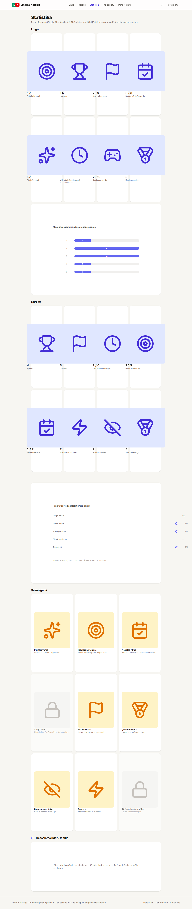

# Lingo & Karogs

Divas leģendāras spēles. Jauns sākums.

Mūsdienīga tīmekļa spēļu platforma divām spēlēm, kas latviešiem pazīstamas kopš
Tildes Biroja laikiem: **Lingo** — piecu burtu vārdu minēšana — un **Karogs** —
stratēģijas spēle ar slepenām armijām. Šis ir **neatkarīgs fanu projekts**: viss
kods, dizains un grafika radīti no jauna, neizmantojot oriģinālo spēļu kodu,
logo, grafiku vai vārdu sarakstus. Projekts nav saistīts ar Tilde vai spēļu
oriģinālo izstrādātāju.

## Ekrānuzņēmumi

| Sākumlapa | Lingo | Karogs | Statistika |
|---|---|---|---|
|  |  |  |  |

## Iespējas

### Lingo

- **Dienas vārds** — viens noteikts vārds visiem spēlētājiem katrā kalendāra
  dienā (Europe/Riga), 5 mēģinājumi, pirmais burts atklāts, rezultāta
  kopīgošana, atpakaļskaitīšana līdz nākamajam vārdam.
- **Neierobežotā spēle** — bezgalīgi nejauši vārdi bez liekas ielādes, sērijas
  un nesen atminēto vārdu izsekošana.
- **Klasiskais Lingo** — spēļu zāles režīms: 5 dzīvības, 5 palīdzības, maksimums
  10 dzīvības, +1 dzīvība par atminējumu ar pirmo mēģinājumu, dokumentēta
  punktu formula (500/400/300/250/200).
- Vairāk nekā **1000 atlasītu mērķvārdu** un **22 000+ derīgu minējumu** no
  brīvi licencētiem avotiem.
- Latviešu alfabēta ekrāna tastatūra, fiziskā tastatūra, vēsturiskā krāsu
  shēma, augsta kontrasta režīms.

### Karogs

- **Pret datoru** — Viegls / Vidējs / Spēcīgs AI (AI redz tikai to, ko redzētu
  īsts spēlētājs).
- **Divatā uz viena ekrāna** — ar privātuma aizkaru starp gājieniem.
- **Spēlēt ar draugu** — privātas istabas ar saiti/kodu, servera pārbaudīti
  gājieni, savienojuma atjaunošana, revanši, servera verificēta līderu tabula.
- **Gatavās formācijas** — pieci pārdomāti sākuma izvietojumi ar vizuāliem
  priekšskatiem, viena pieskāriena spēles sākums, brīva pārveidošana un
  paša saglabātu formāciju izmantošana pret datoru, uz vietas un tiešsaistē.
- Klasiskais 10×10 laukums, divi ezeri, 40 figūras katrā armijā, izlūki,
  mīnētāji, bumbas, spiegs, karogs — pilns noteikumu kopums.

### Vispārīgi

- Statistika, sērijas, sasniegumi un spēļu vēsture (lokāli, bez konta).
- Gaišā/tumšā tēma, mobilais skārienjutīgais izkārtojums, skaņas efekti,
  interaktīvas pamācības abām spēlēm.
- UI sistēma veidota uz **Web Awesome** web komponentēm (pogas, dialogi,
  slēdži, segmentētās vadīklas, paziņojumi) ar SSR/hydration atbalstu Next.js
  vidē un pielāgotu zīmola tēmu (indigo/stones).
- Pārzīmētas militāro figūru grafiskās zīmes un kaujas lauka vizuālais stils.
- Latviešu valodā, bez reģistrācijas.

## Ātrā palaišana lokāli

Prasības: Node.js ≥ 22.

```bash
npm install
npm run dev          # http://localhost:3000
```

Vārdu datubāze (`src/lib/lingo/data/dictionary.json`) jau ir piegādāta kopā ar
repozitoriju. Lai to pārģenerētu no avotiem:

```bash
npm run gen:dict    # lejupielādē/izlasa datu-src, ģenerē dictionary.json
npm run gen:icons   # ģenerē ikonas un sociālo tīklu attēlus
```

Vides mainīgo piemērs atrodas [.env.example](.env.example).

## Tiešsaistes spēle un dati

Tiešsaistes spēlēm nepieciešama noturīga datubāze. Atbalstīti divi režīmi:

- `MULTIPLAYER_STORE=sqlite` — lokālai izstrādei un testiem (SQLite fails
  `.data/lingo-karogs.db`).
- `MULTIPLAYER_STORE=supabase` — ražošanai (Supabase PostgreSQL).

Supabase iestatīšana:

1. Izveido projektu un palaid `supabase/migrations.sql` SQL redaktorā.
2. Nosaki mainīgos: `NEXT_PUBLIC_SUPABASE_URL`,
   `NEXT_PUBLIC_SUPABASE_ANON_KEY`, `SUPABASE_SERVICE_ROLE_KEY`,
   `MULTIPLAYER_STORE=supabase`.
3. `PLAYER_TOKEN_SALT` — pēc izvēles, spēlētāja identifikatoru jaukšanai.

Serveris ir vienīgā autoritāte: katrs gājiens tiek validēts serverī, spēles
stāvoklis tiek saglabāts datubāzē ar versiju optimistiskajai vienlaicības
kontrolei, bet klienti saņem tikai savas puses rediģēto skatu.

## Testi

```bash
npm test            # Vitest: 88 vienības/integrācijas testi (engines, AI, dati, multiplayer, formācijas)
npx playwright install chromium
npm run test:e2e    # Playwright: 38 E2E scenāriji (funkcionālie, a11y, vizuālās regresijas)
npm run typecheck
npm run lint
```

Vizuālo regresiju testu etaloni glabājas `e2e/visual.spec.ts-snapshots/`; lai
apzināti atjauninātu etalonus pēc dizaina izmaiņām:

```bash
npx playwright test e2e/visual.spec.ts --update-snapshots
```

Web Awesome stilus saplacina `scripts/bundle-webawesome-css.mjs` (izvade:
`src/styles/webawesome.css`) — skriptu jāpalaiž pēc `@awesome.me/webawesome`
versijas atjaunināšanas.

## Izvietošana (Vercel)

1. Savieno repozitoriju ar Vercel projektu `lingo-karogs`.
2. Framework Preset: Next.js; Build Command: `npm run build`; Output: `.next`.
3. Nosaki vides mainīgos (sk. `.env.example`).
4. Pārbaudi `/api/health` un izspēlē abas spēles ražošanā.

## Dokumentācija

- [docs/NOTEIKUMI.md](docs/NOTEIKUMI.md) — pilni spēļu noteikumi latviešu valodā.
- [docs/ARHITEKTURA.md](docs/ARHITEKTURA.md) — arhitektūra, drošība, AI uzvedība
  un ierobežojumi.
- [data/NOTICE.md](data/NOTICE.md) — vārdu datu avoti, licences un atribūcija.

## Licences

- Programmas kods: MIT ([LICENSE](LICENSE)).
- Vārdu dati (`src/lib/lingo/data/dictionary.json`): CC BY-SA 4.0, atvasināti no
  Tēzaurs.lv atvērtajiem datiem un CLARIN-LV biežuma kopas — detalizēti
  [data/NOTICE.md](data/NOTICE.md).
